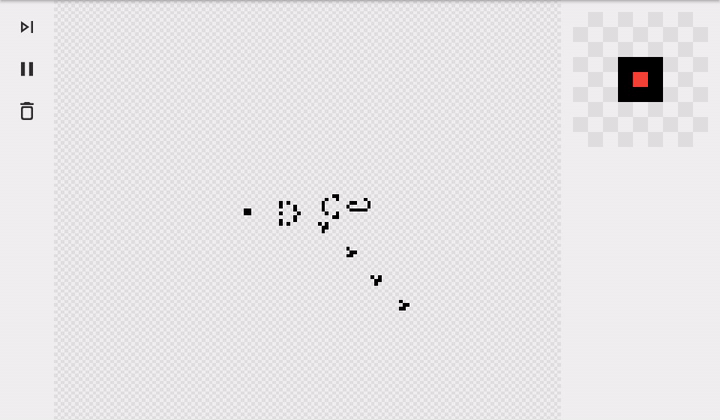

# portfolio-automata

An interactive Conway's Game of Life on an unbounded grid, where you can redraw the neighborhood each cell looks at. Built with Flutter for the web.

**[Live demo](https://portfolio-8b527-automata.web.app)**

<picture>
  <source media="(prefers-color-scheme: dark)" srcset="docs/demo-dark.gif">
  
</picture>

## Highlights

- The world is stored sparsely in 32×32 chunks, packed one bit per cell.
- Each generation does work proportional to the number of live cells, whatever the neighborhood shape.
- Only chunks visible in the viewport are drawn.

## Running locally

```sh
flutter pub get
dart run modular_localization
flutter run -d chrome
```

## License

[BSD 3-Clause](LICENSE)
